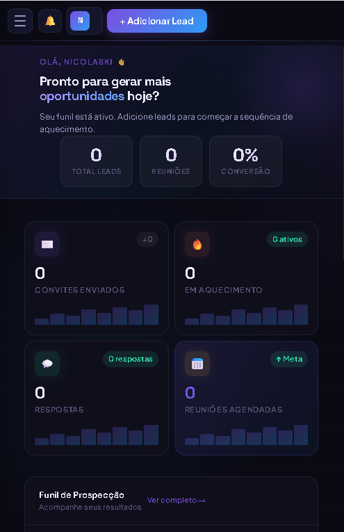
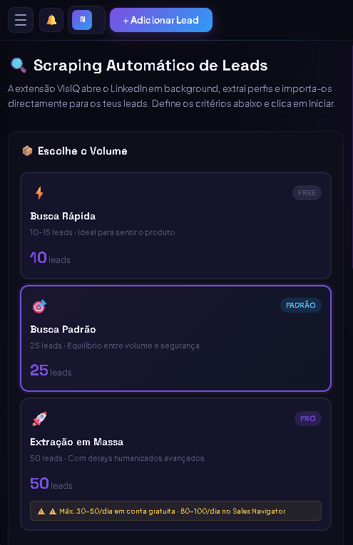
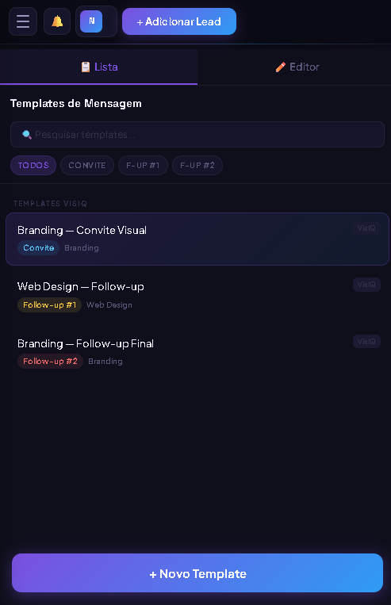
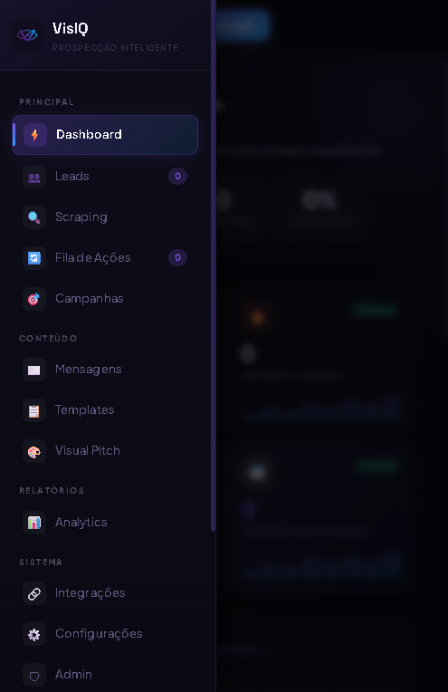
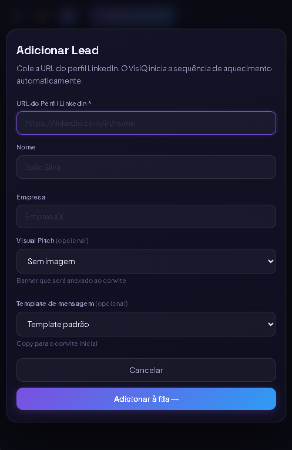
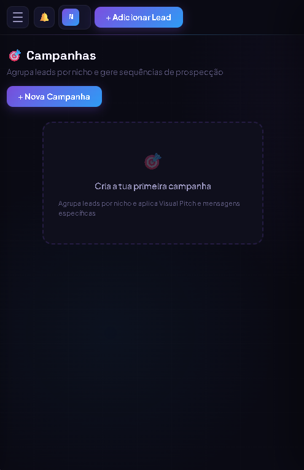

# 🎯 VisIQ — Prospecção Inteligente no LinkedIn

Micro-SaaS de prospecção B2B para LinkedIn: extrai e organiza leads automaticamente, gere campanhas de aquecimento e follow-up, e executa a sequência de contato através de uma extensão de navegador controlada por fila — com assinatura recorrente via Stripe.

<p align="center">
  
  
  
</p>

🔗 **Em produção:** [visiq.pro](https://visiq.pro)

---

## 💡 O problema

Prospecção manual no LinkedIn é lenta e inconsistente: encontrar perfis, copiar dados pra uma planilha, lembrar quem já foi contactado, escrever a mesma mensagem de novo e de novo. E fazer isso rápido demais, na conta errada, gera bloqueio da própria rede social.

## ✅ A solução

O VisIQ automatiza o funil inteiro: uma extensão de navegador extrai perfis do LinkedIn e importa-os como leads; o utilizador organiza-os em campanhas por nicho; e uma **fila de tarefas com janela de horário de trabalho** dispara os convites e mensagens de follow-up de forma espaçada e humanizada, reduzindo o risco de bloqueio — enquanto o dashboard mostra a conversão de cada etapa do funil.

---

## ✨ Funcionalidades

### Dashboard e funil de prospecção
Métricas em tempo real de convites enviados, leads em aquecimento, respostas recebidas e reuniões agendadas — com o funil completo de conversão visível de forma central.

### Scraping automático de leads
A extensão do VisIQ abre o LinkedIn em background, extrai perfis de acordo com o volume escolhido (com limites diferentes por plano — grátis, padrão, pro) e importa-os diretamente para a lista de leads.

<p align="center">
  
</p>

### Campanhas por nicho
Agrupamento de leads em campanhas, cada uma com o seu próprio Visual Pitch (imagem de prospecção) e mensagens específicas.

<p align="center">
  
</p>

### Templates de mensagem
Biblioteca de modelos reutilizáveis para convite inicial e follow-ups, organizados por categoria e prontos a aplicar em qualquer lead.

<p align="center">
  
</p>

### Adicionar lead com sequência automática
Um único formulário — URL do perfil, Visual Pitch e template — inicia toda a sequência de aquecimento automaticamente, sem mais passos manuais.

<p align="center">
  
</p>

### Navegação
Estrutura organizada por área: Dashboard, Leads, Scraping, Fila de Ações, Campanhas, Mensagens, Templates, Visual Pitch, Analytics, Integrações, Configurações e Admin.

<p align="center">
  
</p>

### Assinaturas via Stripe
Planos Starter e Growth (mensal/anual), checkout, portal de gestão de assinatura e sincronização automática de status via webhook.

### Painel administrativo
Estatísticas da base de utilizadores (total, por plano, trials ativos), gestão de contas e envio de emails/anúncios da plataforma.

### Autenticação própria
Sistema de login com **JWT assinado via HMAC**, implementado do zero (sem bibliotecas externas), com verificação de email e recuperação de senha.

---

## 🛠️ Stack técnica

| Item | Detalhe |
|---|---|
| Backend | PHP puro, roteador single-file (`api/index.php`) com rotas organizadas em `api/routes/` |
| Banco de dados | MySQL via PDO, com prepared statements em todas as queries |
| Autenticação | JWT minimalista implementado do zero (HMAC-SHA256, verificação com `hash_equals` para evitar timing attacks) |
| Pagamentos | Stripe (Checkout, Customer Portal, Webhooks com verificação de assinatura HMAC) |
| Frontend | Dashboard SPA em HTML/JS, design escuro e focado em dados |
| Extensão | Chrome extension que consome a API de fila de tarefas para executar as ações no LinkedIn |
| Hosting | Hostinger |

---

## ⚙️ Configuração local

As credenciais reais ficam em `api/config.php`, que **não é versionado** (está no `.gitignore`).

1. Copia o modelo:
   ```bash
   cp api/config.example.php api/config.php
   ```
2. Preenche os valores reais: credenciais da base de dados, chave secreta do Stripe, signing secret do webhook, e um `JWT_SECRET` aleatório forte:
   ```bash
   php -r "echo bin2hex(random_bytes(32));"
   ```
3. Configura o endpoint de webhook no Stripe Dashboard apontando para `/api/stripe/webhook`.

---

## 🔒 Segurança

- Todas as queries usam PDO com prepared statements.
- Tokens JWT verificados com comparação segura contra timing attacks (`hash_equals`).
- Assinatura dos webhooks do Stripe validada via HMAC antes de processar qualquer evento.
- Pasta `uploads/` bloqueada por `.htaccess` para impedir execução de scripts, aceitando apenas arquivos de imagem.
- Nenhuma credencial ou chave fica no código-fonte — tudo vem de `api/config.php`, fora do controlo de versão.
- A fila de automação respeita uma janela de horário de trabalho configurável, reduzindo o risco de bloqueio da conta de LinkedIn do utilizador.

---

## 📌 Contexto

Projeto SaaS próprio, em produção. Este repositório é uma versão para portfólio — sem credenciais, sem dados reais de utilizadores e sem uploads de conteúdo gerado por usuários.

---

## 👤 Autor

Desenvolvido solo por **Nicolas Kaiky** — desenvolvedor independente, focado em produtos SaaS para os mercados português e brasileiro.

💼 [LinkedIn](https://www.linkedin.com/in/nicolas-kaiky/) · 🐙 [GitHub](https://github.com/NicolasKCost) · ✉️ [nicolaskcost@gmail.com](mailto:nicolaskcost@gmail.com)
